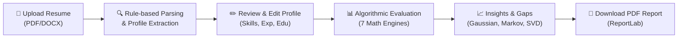

# 🎯 CareerLens

> **Automated Resume Evaluation & Career Recommendation Platform**  
> Powered by FastAPI, React (Neumorphic UI), Firebase Firestore, and Advanced Mathematical Modeling.

---

## 📌 Overview

**CareerLens** is an intelligent career guidance platform designed to bridge the gap between job candidates and job requirements. Candidates upload their resumes in PDF or DOCX format, review their auto-extracted profiles, and receive a comprehensive **0–100 Resume Quality Score**, **Job Compatibility Ranking**, **Actionable Skill Gap Insights**, and a **Career Growth Roadmap**.

All candidate profiles, job catalogs, evaluations, and analysis reports are securely persisted in **Google Cloud Firestore**. Uploaded resume documents are stored locally on the server filesystem.

---

## 🚀 Key Features

### 👤 Candidate Features
* **Resume Parsing:** Upload PDF or DOCX files with automatic text and skill extraction.
* **Interactive Profile Editor:** Inspect and fine-tune extracted skills, education, and experience.
* **Algorithmic Compatibility:** Multi-factor scoring against job descriptions.
* **Mathematical Insights:** Visual Gaussian distribution curves, confidence intervals, and hypothesis tests.
* **Skill Gap Analysis:** Highlights exact missing skills needed for target roles.
* **Markov Career Pathways:** Multi-stage career progression model showing transition probabilities.
* **Exportable PDF Report:** Generate and download official evaluation reports with ReportLab.

### 🛡️ Admin Features
* **Job Catalog Management:** Create, edit, and delete job postings and requirement taxonomies.
* **Category Organization:** Categorize and manage job domains.
* **Platform Analytics:** Candidate statistics, evaluation histories, and validation benchmarks.

---

## 🛠️ Technology Stack

| Layer | Technologies |
|---|---|
| **Frontend** | React 18, Vite, Tailwind CSS (Neumorphic styling), Recharts, Lucide Icons |
| **Backend** | Python 3.10–3.12, FastAPI, Uvicorn, Pydantic |
| **Database & Storage** | Google Cloud Firestore (metadata & profiles), Local Filesystem (resumes) |
| **Math & ML Engine** | NumPy, SciPy, scikit-learn (SVD, Bayesian models, Markov Chains) |
| **Document Processing** | PyMuPDF (fitz), python-docx, ReportLab (PDF generation) |

---

## 📐 Mathematical & Algorithmic Architecture

CareerLens uses deterministic statistical and linear algebra models to evaluate candidates without runtime randomness:

```
┌────────────────────────────────────────────────────────────────────────┐
│                   Overall Compatibility Score (0 - 100%)               │
├──────────────┬──────────────┬──────────────┬─────────────┬─────────────┤
│ Skill Match  │  Education   │  Experience  │ Probability │ Latent Fit  │
│    (45%)     │    (10%)     │    (10%)     │    (20%)    │    (15%)    │
└──────────────┴──────────────┴──────────────┴─────────────┴─────────────┘
```

### The 7 Mathematical Modules (`app/algorithms/`)

| Module | Source File | Purpose & Formulation |
|---|---|---|
| **1. Inner Product** | `inner_product.py` | Calculates cosine similarity and requirement coverage between candidate skill vectors and job requirement vectors. |
| **2. Bayes' Theorem** | `bayes_model.py` | Computes posterior probability $\mathcal{P}(\text{Suitable} \mid \text{Skills}, \text{Edu}, \text{Exp})$ using prior beliefs and per-skill likelihood ratios. |
| **3. Conditional Probability** | `conditional_probability.py` | Empirical $\mathcal{P}(\text{Suitable} \mid \text{Coverage Bin}, \text{Edu Met}, \text{Exp Met})$ smoothed via Laplace estimation from a calibration baseline. |
| **4. Truncated SVD** | `svd_analysis.py` | Rank-3 matrix decomposition of the Job-Skill matrix to discover latent semantic roles and project candidate fit. |
| **5. Gaussian Distribution** | `gaussian_analysis.py` | Evaluates resume scores against cohort mean & variance (Z-score, percentiles, confidence intervals, and Shapiro-Wilk normality testing). |
| **6. Markov Chain** | `markov_chain.py` | 5-stage career readiness state transitions; calculates expected months to milestones via the fundamental matrix $(I - Q)^{-1}$. |
| **7. Hypothesis Testing** | `hypothesis_testing.py` | Paired t-test (Brier score error) & McNemar's test comparing the CareerLens multi-factor engine against simple keyword matchers. |

---

## 📂 Project Structure

```text
CareerLens/
├── career-lens-frontend/       # React (Vite) client application
│   ├── src/
│   │   ├── components/         # Reusable UI widgets & neumorphic controls
│   │   ├── context/            # AuthContext & ResumeContext
│   │   ├── layouts/            # Page layouts & navigation bars
│   │   ├── pages/              # Application views (Dashboard, Evaluation, etc.)
│   │   └── services/           # Axios API client layer
│   └── package.json
│
├── career-lens-backend/        # FastAPI backend service
│   ├── app/
│   │   ├── algorithms/         # The 7 mathematical & statistical models
│   │   ├── routes/             # REST API endpoints (/api/auth, /api/resumes, etc.)
│   │   ├── services/           # Extraction, scoring, PDF reporting, seed data
│   │   ├── database.py         # Firestore database adapter
│   │   ├── config.py           # Environment settings & secrets
│   │   └── main.py             # FastAPI entrypoint & middleware
│   ├── scripts/                # Database initialization scripts
│   ├── uploads/resumes/        # Uploaded resume documents (local storage)
│   └── requirements.txt
│
└── database/
    ├── firestore.rules         # Recommended Firestore security rules
    └── FIRESTORE_COLLECTIONS.md# Document schema specifications
```

---

## ⚡ Windows Quick Start Guide

### Step 1: Prerequisites
* **Python**: Version 3.10 to 3.12 installed ([python.org](https://www.python.org/downloads/)). *Ensure "Add python.exe to PATH" is checked.*
* **Node.js**: Version 18+ LTS installed ([nodejs.org](https://nodejs.org/)).
* **Firebase Account**: A free Google account for Firebase Firestore.

---

### Step 2: Setup Firebase Firestore

1. Open the [Firebase Console](https://console.firebase.google.com/) and click **Create a project** (e.g., `careerlens`).
2. In the left navigation, go to **Build** → **Firestore Database** → **Create database**.
   * Mode: Select **Start in production mode**.
   * Location: Pick your preferred region (e.g., `asia-south1 (Mumbai)`).
3. Generate service account credentials:
   * Go to **Project Settings** (gear icon) → **Service accounts** tab.
   * Click **Generate new private key** → **Generate key**.
   * Save the downloaded `.json` file as:
     ```
     CareerLens\career-lens-backend\firebase-service-account.json
     ```
4. *(Optional but Recommended)* Apply database security rules:
   * In the Firebase Console, go to **Firestore Database** → **Rules**.
   * Paste the content of [`database/firestore.rules`](database/firestore.rules) and click **Publish**.

---

### Step 3: Backend Setup

Open a PowerShell terminal:

```powershell
# 1. Navigate to backend directory
cd career-lens-backend

# 2. Create and activate a Python virtual environment
python -m venv venv
.\venv\Scripts\activate

# 3. Install Python dependencies
pip install -r requirements.txt

# 4. Create environment configuration
copy .env.example .env
```

Verify your `.env` contains:
```ini
DB_BACKEND=firestore
FIREBASE_CREDENTIALS=firebase-service-account.json
SECRET_KEY=replace-with-a-secure-random-string
CORS_ORIGINS=http://localhost:5173,http://127.0.0.1:5173
```

Initialize the database and start the server:
```powershell
# 5. Seed Firestore with default admin account and sample jobs
python -m scripts.init_db

# 6. Run the FastAPI development server
uvicorn app.main:app --reload --port 8000
```

> **API Endpoints:**
> * Base URL: `http://localhost:8000/`
> * Swagger API Documentation: `http://localhost:8000/docs`
> * Health Check: `http://localhost:8000/api/health`

---

### Step 4: Frontend Setup

Open a **second** PowerShell terminal:

```powershell
# 1. Navigate to frontend directory
cd career-lens-frontend

# 2. Install Node dependencies
npm install

# 3. Create frontend environment configuration
copy .env.example .env

# 4. Start the Vite development server
npm run dev
```

> **Frontend Application:**
> * Open your browser at: `http://localhost:5173`

---

### Step 5: Default Credentials & Login

| Account Type | Email | Password | Role |
|---|---|---|---|
| **Administrator** | `admin@careerlens.com` | `Admin@123` | Full access to jobs, categories, and analytics |
| **Candidate** | *(Register via the UI)* | Must be 8+ chars (Upper, lower & number) | Upload resumes, run evaluations, download reports |

---

## 🔄 End-to-End Workflow



1. **Register / Login:** Authenticate as a candidate or admin.
2. **Upload Resume:** Drop a PDF or DOCX file on the upload dashboard.
3. **Verify Extracted Information:** Inspect parsed skills, education degrees, and work history. Edit any fields if necessary.
4. **View Evaluation:** Review the compatibility score, matched/missing skills, Gaussian cohort comparisons, and Markov progression estimates.
5. **Explore Careers & Gaps:** Identify targeted skills needed for higher-tier positions.
6. **Download Report:** Export a formal PDF analysis report.

---

## 🧪 Automated Testing

To test the complete workflow (parsing, math models, and evaluation flow) without connecting to Firebase:

```powershell
cd career-lens-backend
.\venv\Scripts\activate
python -m tests.test_workflow
```
*(Uses an in-memory / local JSON store for isolated verification).*

---

## 🔬 Assumptions & Technical Notes

> [!NOTE]
> * **Validation Cohort**: Baseline statistical benchmarks use a deterministic cohort (400 simulated candidate-job cases generated via `services/reference.py`). 200 cases calibrate the conditional probability tables, and 200 are reserved for paired hypothesis tests.
> * **Gaussian Baseline**: Cohort normality is tested via Shapiro-Wilk ($p$-values reported). Empirical percentiles are displayed if normality is rejected, switching dynamically to platform data once $\ge 20$ live resumes are analyzed.
> * **Latent SVD Decomposition**: Truncated SVD discovers latent skill relationships across the job catalog; representations grow richer as more job descriptions are added.
> * **Rule-Based Resume Extraction**: Parsing relies on structured section headers and an extensible taxonomy (`skills_taxonomy.py`). Any ambiguous or missed items can be edited directly in the UI before running evaluations.
> * **Decision Support**: Scores provide objective analytical metrics to assist candidates and recruiters—they are designed to augment, not replace, human assessment.

---

## ❓ Troubleshooting

| Issue | Cause | Solution |
|---|---|---|
| `Firebase service-account key not found` | Missing credential JSON | Ensure `firebase-service-account.json` exists in `career-lens-backend/` and matches `FIREBASE_CREDENTIALS` in `.env`. |
| `403 Cloud Firestore API has not been used` | Firestore API disabled or database not initialized | Open Firebase Console → Firestore Database → click **Create database**. Wait 60 seconds and retry. |
| `PERMISSION_DENIED` | Project mismatch | Verify the service account key was downloaded from the same project created in Firestore. |
| Browser shows *Cannot reach the server* | Backend offline or bad URL | Ensure FastAPI is running on port 8000 and `VITE_API_URL=http://localhost:8000/api` in frontend `.env`. |
| `CORS Error` in browser console | Origin not allowed | Verify `CORS_ORIGINS` in `career-lens-backend/.env` includes `http://localhost:5173`. |
| PowerShell script activation error | Restricted execution policy | Run `Set-ExecutionPolicy -Scope CurrentUser RemoteSigned` in PowerShell once. |
